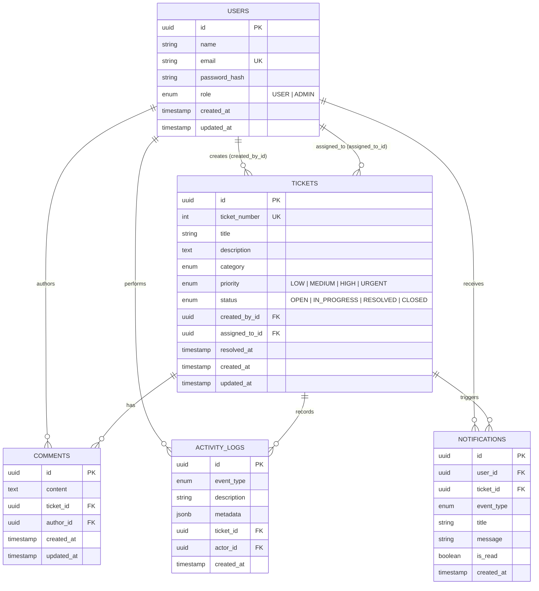

# Database Design Explanation

## 1. Choice of Database: PostgreSQL + Prisma ORM

A Support Ticket Management System has strongly relational entities (`Users`, `Tickets`, `Comments`, `ActivityLogs`, `Notifications`) with strict invariants:
- Every ticket must belong to a valid `User` (`created_by_id`).
- Comments, activity logs, and notifications require referential integrity (`ON DELETE CASCADE`).
- Enumerated domain states (`Role`, `TicketStatus`, `TicketPriority`, `TicketCategory`, `EventType`) prevent invalid values at the database level.
- Sequential human-readable ticket numbers (`ticket_number SERIAL/AUTOINCREMENT`) are guaranteed atomic by PostgreSQL sequences.

## 2. Entity-Relationship Diagram

## 3. Indexing Strategy

| Table | Index | Rationale |
|---|---|---|
| `users` | `email` (UNIQUE) | Fast login lookups & duplicate email prevention |
| `users` | `role` | Fast lookup of all `ADMIN` recipients during event notifications |
| `tickets` | `status`, `priority`, `category` | Supports admin filtering & `GROUP BY` dashboard analytics |
| `tickets` | `created_by_id`, `assigned_to_id` | Fast user-scoped ticket lists & admin workload filtering |
| `tickets` | `created_at` | Efficient default sorting (`ORDER BY created_at DESC`) & pagination |
| `comments` | `(ticket_id, created_at)` | Fast chronological comment thread loading per ticket |
| `activity_logs` | `(ticket_id, created_at)` | Fast audit timeline rendering on ticket detail page |
| `notifications` | `(user_id, is_read, created_at)` | Composite index for unread badge count & notification inbox |

## 4. Referential Integrity & Cascading Rules

- **Ticket -> User (`createdBy`)**: `ON DELETE CASCADE` (removing a user cleans up their tickets).
- **Ticket -> User (`assignedTo`)**: `ON DELETE SET NULL` (if an admin leaves, tickets remain intact and simply become unassigned).
- **Comment / ActivityLog / Notification -> Ticket**: `ON DELETE CASCADE` (deleting an open ticket cleans up child threads and logs automatically).
